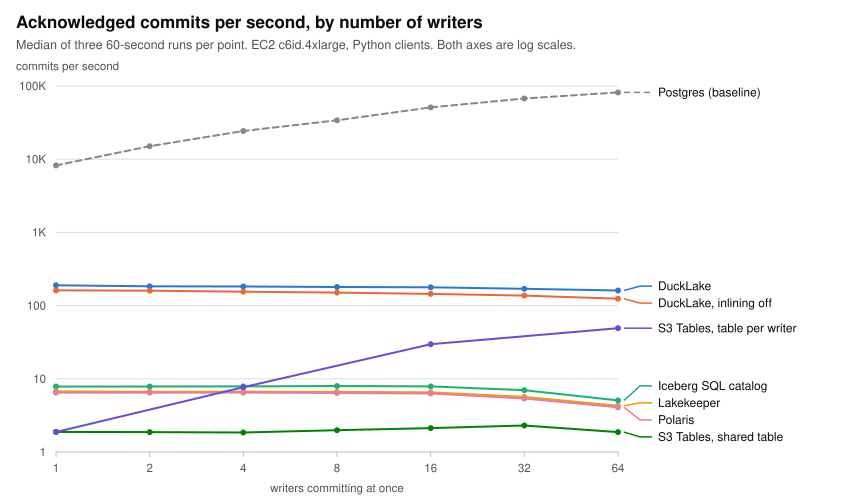

# catalog-bench

An open benchmark of lakehouse catalogs: how many commits per second each one accepts as writers are added, and how a whole write, close, read and reprocess pipeline behaves on each storage option.

[Results site](https://jj-scoll.github.io/catalog-bench/) · [Methodology](docs/methodology.md) · [Pipeline workload](docs/pipeline.md) · [Running it](docs/running.md) · [Adding a system or option](docs/adding-a-system.md)

One small file per system, one results format, and every number reproducible from this repository.

**Status: early.** Six systems are implemented: raw Postgres as a baseline, DuckLake on Postgres, the Iceberg SQL catalog on Postgres, Amazon S3 Tables, Lakekeeper and Polaris. All six have a published in-region run. A second workload, a whole pipeline flow, has single-run results for nine storage options in `results/pipeline/`: plain Parquet and Vortex files, DuckLake, Iceberg, Delta Lake and Lance.

## Key findings

Pipeline figures are from a single run each, with batch data on S3 and a load of 6 traces of 300 batches arriving at 1.25 batches/s unless stated. The Delta Lake, Lance and Vortex runs shared one instance and ran at the same time, so their timings include contention with each other; the DuckLake and Iceberg runs each had an instance to themselves. Commit rates are acknowledged single-row commits per second, each the median of three 60-second runs.

Choosing a storage format (pipeline workload):

- **Delta Lake and Lance kept to 1.25 batches/s while committing on every batch. Iceberg did not.** A batch took 1,285 ms at the median on Delta Lake and 634 ms on Lance, and no batch started more than 10.2 ms late. Committing to Iceberg on every batch took 6.1 s per batch on S3 Tables (with 3 traces, not 6) and fell 49.7 s behind; on the Iceberg SQL catalog with data on local disk it fell 1,702 s behind.
- **Committing once per trace cost about the same to close on Delta Lake, Lance and S3 Tables.** The slowest close of a 300-batch trace took 8.9 s on Delta Lake, 10.9 s on Lance and 9.4 s on Iceberg with S3 Tables. Delta Lake and Lance did it with no catalog service. A reader then loaded the trace in 395 ms from Delta Lake, 971 ms from Lance (488 ms after compaction) and 271 ms from S3 Tables.
- **DuckLake on Aurora remains far faster to close a trace.** Its slowest close was 82 to 87 ms, against 8.9 to 10.9 s for the three options above and 1.2 s for Delta Lake committing on every batch. Its batch writes took 94 to 96 ms and its trace reads 340 to 349 ms. It needs a Postgres database, which Delta Lake, Lance and plain files do not.
- **Vortex files read back about twice as fast as Parquet files, and wrote no slower.** Reading a 300-batch trace took 2.7 s from Vortex and 5.9 s from Parquet in the same set of runs; a batch write took 361 ms and 358 ms. The readers differ as well as the formats: Vortex is read through DuckDB, Parquet through pyarrow. Both are slower than reading a trace from a table committed once per trace (271 to 971 ms).
- **With the pacing removed, committing on every batch broke down on both Delta Lake and Lance.** Lance wrote 3.6 batches/s with 135 failed batch writes, all delivered again and verified. Delta Lake produced no result: delta-rs timed out fetching instance credentials. Committing once per trace, Delta Lake wrote 30.5 batches/s and Lance 28.9, close to the 29.3 of Iceberg on S3 Tables.
- **Committing once per trace moves the cost to closing the trace, and it grows with the trace.** On S3 Tables the slowest close took 9.4 s for a 300-batch trace and 237 s for a 9,000-batch trace. The larger sizes were not run on Delta Lake or Lance.

Commit rate:

- **The Python Iceberg client, not the catalog, sets the Iceberg commit rate.** The Iceberg SQL catalog, Lakekeeper and Polaris accept 7.9, 6.7 and 6.5 commits/s with one writer. The catalog call is 11 to 20 ms of a 128 to 149 ms commit; pyiceberg and its object writes take the rest.
- **DuckLake on Postgres does not scale with writers.** It accepts 189 commits/s with one writer and 161 with 64. In every run with more than one writer, a single writer made all but a handful of the commits.
- **Amazon S3 Tables scales by table, not by writer.** One shared table stays between 1.8 and 2.3 commits/s from 1 to 64 writers. One table per writer reaches 49.1 commits/s at 64 writers, with 45% of attempts refused with Too Many Requests.
- **Raw Postgres is not the limit for any of them.** The baseline accepts 8,240 commits/s with one writer and 81,667 with 64, and is still rising.

## Commit rate

N writer processes each commit one single-row insert at a time, as fast as the system acknowledges them.

<picture>
  <source media="(prefers-color-scheme: dark)" srcset="docs/img/commit-rate-dark.svg">
  
</picture>

Two passes on 2026-11-25, each system on its own EC2 c6id.4xlarge (16 vCPUs, instance-store NVMe) in ca-central-1, with Postgres 18 in Docker on the same host and S3 Tables in the same region. The second pass used different instances of the same type from the first. Each point is the median of three 60-second runs. Every run passed verification. The raw numbers are in `results/`.

| System | 1 writer | 16 writers | Most writers measured | What limits it |
|---|---|---|---|---|
| Postgres (baseline) | 8,240 | 51,054 | 81,667 at 64 | Nothing reached; still rising |
| DuckLake on Postgres | 189 | 178 | 161 at 64 | Does not scale with writers, and writers starve: in every run with more than one writer, a single writer made all but a handful of the commits and each of the others made one or none |
| DuckLake on Postgres, inlining off | 162 | 145 | 124 at 64 | The same pattern, about 14% lower at one writer: every commit now writes a Parquet file |
| S3 Tables, one table per writer | 1.9 | 29.7 | 49.1 at 64 | Scales with tables until the service throttles: 45% of attempts at 64 writers were refused with Too Many Requests |
| Iceberg SQL catalog on Postgres | 7.9 | 7.9 | 5.1 at 64 | The client: the catalog call is 11 ms of a 128 ms commit, and conflicts take the rest as writers are added. 7.0 at 32 |
| Lakekeeper | 6.7 | 6.5 | 4.3 at 64 | The client: the catalog call is 17 ms of a 149 ms commit at one writer. Flat to 16 writers, then conflicts cost throughput |
| Polaris | 6.5 | 6.3 | 4.1 at 64 | The client: the catalog call is 20 ms of a 149 ms commit at one writer. Same shape as Lakekeeper |
| S3 Tables, one shared table | 1.9 | 2.1 | 1.9 at 64 | Commit conflicts, then throttling; the catalog call is 72 ms of a 528 ms commit |

All figures are acknowledged commits per second. "Inlining" is DuckLake's default of keeping a small insert as rows in the catalog database instead of writing a Parquet file.

## Pipeline workload

The commit ramp isolates one call. The pipeline workload runs the whole flow a batch pipeline has, against a storage option. Load arrives as *traces*, each a group of *batches* that is closed and read as a unit; a batch is 5,000 rows here, written by one of 16 workers in one call. When a trace's batches are in, a finaliser *closes* it, readers load every trace and the rows are compared with what was acknowledged, and one trace is then reprocessed under a new version that must replace the old rows. If the option has *compaction* (maintenance that merges small data files into larger ones), it runs and the reads are repeated.

<picture>
  <source media="(prefers-color-scheme: dark)" srcset="docs/img/pipeline-dark.svg">
  
</picture>

The table is the paced run: 6 traces of 300 batches arriving at 1.25 batches/s, on an EC2 c6id.4xlarge in ca-central-1 on 2026-11-25. **Each row is a single run**, so treat small differences as noise. The six rows marked † ran at the same time on one instance, so their timings include contention with each other. Every other row had an instance to itself.

| Option | Backed by | Writes/s | Batch commit p50 (ms) | Furthest behind schedule (ms) | Slowest close (ms) | Read one trace p50 (ms) | Same read after compaction (ms) | Verified |
|---|---|---|---|---|---|---|---|---|
| `files` | S3, no catalog | 1.28 | 342 | <1 | 331 | 5,724 | n/a | yes |
| `ducklake` | Postgres in Docker on the runner | 1.28 | 15.6 | <1 | 55.2 | 50.7 | 39.4 | yes |
| `ducklake` | Aurora PostgreSQL, provisioned | 1.28 | 93.9 | <1 | 81.9 | 349 | 95.6 | yes |
| `ducklake` | Aurora Serverless v2 | 1.28 | 96.3 | <1 | 87.3 | 340 | 98.0 | yes |
| `iceberg-per-trace` | Iceberg SQL catalog on local Postgres | 1.28 | 3.0 | <1 | 495 | 13.0 | n/a | yes |
| `iceberg-per-trace` | Lakekeeper | 1.28 | 3.0 | <1 | 681 | 25.0 | n/a | yes |
| `iceberg-per-trace` | Polaris | 1.28 | 3.1 | <1 | 649 | 26.9 | n/a | yes |
| `iceberg-per-trace` | Amazon S3 Tables | 1.27 | 341 | <1 | 9,407 | 271 | n/a | yes |
| `iceberg-per-batch` | Iceberg SQL catalog on local Postgres | 1.07 | 1,798 | 1,702,218 | 2,355 | 721 | n/a | yes |
| `iceberg-per-batch` | Amazon S3 Tables (3 traces, not 6) | 1.13 | 6,133 | 49,679 | 27,368 | 2,167 | n/a | yes |
| `files` † (rerun) | S3, no catalog | 1.28 | 358 | 116 | 287 | 5,854 | n/a | yes |
| `vortex` † | S3, no catalog | 1.28 | 361 | 185 | 292 | 2,712 | n/a | yes |
| `delta-per-trace` † | S3, no catalog | 1.27 | 360 | 34.3 | 8,933 | 395 | 399 | yes |
| `delta-per-batch` † | S3, no catalog | 1.27 | 1,285 | 10.2 | 1,151 | 2,057 | 1,341 | yes |
| `lance-per-trace` † | S3, no catalog | 1.27 | 359 | 8.3 | 10,872 | 971 | 488 | yes |
| `lance-per-batch` † | S3, no catalog | 1.27 | 634 | 5.2 | 3,928 | 4,339 | 346 | yes |

How to read it:

- `files` is plain Parquet with no catalog, and `vortex` is the same with Vortex files written and read through DuckDB. `ducklake` is one DuckLake transaction per batch. `iceberg-per-batch`, `delta-per-batch` and `lance-per-batch` make two commits per batch to Iceberg, Delta Lake or Lance tables. `iceberg-per-trace`, `delta-per-trace` and `lance-per-trace` write each batch as a plain Parquet file and commit to the table only when the trace closes.
- The † rows are the third set of runs: `files` again as a reference, and the five options added since. All six ran at once on one 16-vCPU instance. They started batches up to 185 ms late where the earlier rows were under 1 ms late; sharing the instance is the likely cause, and it was not isolated. The batch write and trace read of the `files` rerun are within 5% of the first `files` row, and its slowest close is 13% shorter.
- "Writes/s" counts every acknowledged write. Every 50th batch is deliberately delivered twice, so a run that keeps to the 1.25 batches/s schedule shows about 1.28.
- "Verified" means no acknowledged row was missing, duplicated or left over from an old version, after the first read, after reprocessing and, where it ran, after compaction.
- "Backed by" names the catalog or metadata store. "S3, no catalog" means there was no catalog service: the Delta Lake log and the Lance manifests are objects beside the data. Aurora was one provisioned db.r8g.xlarge instance and one Serverless v2 cluster set to 0.5 to 16 ACU, both PostgreSQL 16.8.
- **Batch data did not go to the same place in every row.** The "S3, no catalog", Aurora and S3 Tables rows wrote batch data to S3. The rows backed by something on the runner (local Postgres, the Iceberg SQL catalog, Lakekeeper, Polaris) wrote it to the runner's instance-store NVMe. Their 3 to 16 ms batch writes are local disk writes and are not comparable with the S3 rows (94 ms and up).
- With the pacing removed, `ducklake` wrote 46.2 batches/s on local Postgres, 24.3 on provisioned Aurora and 23.6 on Aurora Serverless v2 (4 traces of 500 batches, one run each). In the third set, run one at a time, `files` wrote 44.1 batches/s, `vortex` 42.1, `delta-per-trace` 30.5 and `lance-per-trace` 28.9, against 29.3 for `iceberg-per-trace` on S3 Tables earlier. `lance-per-batch` wrote 3.6 batches/s with 135 failed writes, all delivered again. `delta-per-batch` produced no result.

All 35 runs, the other load shapes and the definition of each column are in [docs/pipeline.md](docs/pipeline.md). The results site shows them too, in its pipeline section.

## Quick start

Needs Docker and [uv](https://docs.astral.sh/uv/).

```sh
docker compose up -d --wait
uv run python -m bench.run --writers 1 4 16 --seconds 10 --out results/local.json
uv run pytest
```

`--systems` picks a subset; the default is all of them. Connection settings come from `BENCH_PG` and `BENCH_DATA_PATH` (see `bench/config.py`).

The pipeline workload:

```sh
uv run python -m bench.pipeline --options files ducklake iceberg-per-batch iceberg-per-trace \
  --traces 4 --batches 100 --rows 1000 --workers 8 --rate 5 --redeliver-every 20 --out results/pipeline/local.json
```

Lakekeeper, Polaris and Amazon S3 Tables have setup notes in [docs/running.md](docs/running.md).

## What this does not show

Commit rate:

- For the five Iceberg rows the Python client (pyiceberg) and its object writes take most of each commit, so these are rates for that client, not ceilings for the catalogs. A catalog-only workload is planned.
- The DuckLake row is not like for like with the Iceberg rows. With default settings DuckLake keeps a single-row insert inline in the catalog database and writes no Parquet file, so its commit is one Postgres transaction. The Iceberg rows write data and metadata files on every commit. The "inlining off" row is the closer comparison.
- The Iceberg SQL points at 32 and 64 writers, the DuckLake point at 64, and the Lakekeeper, Polaris and inlining-off rows come from the second pass, so they ran on different instances from the rest.
- Single-row commits are the worst case for a catalog on purpose: they isolate commit cost from data volume. Batched and multi-table workloads are planned.
- Only the last attempt's catalog call is timed when the client retries a commit.
- The Python client's cost is negligible for raw Postgres (checked against `pgbench`). For the Iceberg systems it is most of each commit, so those rows measure pyiceberg as much as the catalog.

Pipeline workload:

- Every pipeline figure is from one run. There are no repetitions and no medians yet.
- The Delta Lake, Lance and Vortex paced runs, and the `files` rerun beside them, ran at the same time on one instance. Their timings include contention with each other, and the earlier rows do not have that. Do not read a gap of a few percent between a † row and another row as a difference between formats.
- `delta-per-batch` has no unpaced result. With the pacing removed, delta-rs timed out fetching instance credentials from the instance metadata service and a trace could not be closed. Two attempts ended the same way. The option opened the table on every call and each open loaded credentials. It was not a commit conflict. The option now keeps one open table per process, which has not yet been run on S3.
- How Delta Lake and Lance arbitrate concurrent commits on S3 in this setup was not examined. No lock table was used. The runs passed verification, which shows no row was lost or duplicated in these runs, not that the setup is safe in general.
- The Vortex and Parquet file reads use different readers (DuckDB and pyarrow), so the gap between them is not the file format alone. `vortex` also writes one file per delivery instead of overwriting, because DuckDB's vortex extension 0.92.0 returns stale results for a file overwritten at the same key.
- The Iceberg options cannot yet reset Lakekeeper or Polaris for a second run, so those two have one pipeline run each, at one load shape.
- `iceberg-per-batch` on S3 Tables was run only at smaller shapes (2 or 3 traces), so its row above is not the same load as the others.
- The result files do not record the Aurora instance class or capacity setting, or where batch data files were written for the catalog-backed options. Those facts are stated above from the run setup, not from the files. The capacity Serverless v2 actually used during a run was not recorded.
- The runs backed by a catalog on the runner wrote batch data to local NVMe, not S3, so they understate what the same option costs with data on S3.

Both:

- Results from a workstation or a shared CI runner are noisy. Compare systems within one run on one machine, not across machines.
- Error messages in the published files have long numeric identifiers replaced with `<id>` and home directories with `<home>`.

## More detail

| Document | What is in it |
|---|---|
| [docs/methodology.md](docs/methodology.md) | What the commit-rate workload measures, the rules for a fair entry, the results format |
| [docs/pipeline.md](docs/pipeline.md) | The pipeline steps, the nine options, the load shapes, what each column means, all 35 runs |
| [docs/running.md](docs/running.md) | Local services (Lakekeeper, Polaris, RustFS), Amazon S3 Tables, and the CA bundle fix for certificate errors |
| [docs/adding-a-system.md](docs/adding-a-system.md) | Adding a system to the commit-rate workload or an option to the pipeline workload |
| [docs/results-site.md](docs/results-site.md) | Building the results site locally, and what the GitHub workflows do |
